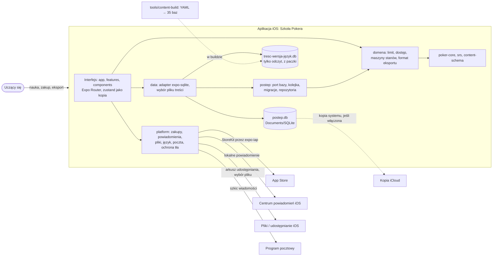

# Architektura: Szkoła Pokera
Rola 05 Architekt systemu, tryb build, E4 · 2026-11-04 (piętnasta sesja) · Prompt: `assemble.mjs 05-architekt --tryb build` (repo prompts, klon 2026-11-04; moduły `dane-lokalne-sqlite`, `pakiety-tresci`, `tlo-i-sensory-ios`), przeczytany w całości. Dokument jest krótki: szczegóły są w plikach, do których prowadzą odnośniki.

## 1. Cel i zakres
- Architektura obsługuje przepływy PR-01–PR-09 i funkcje F-01–F-18 z [`docs/scope-contract.md`](../scope-contract.md) (D-112) i projekt z [`docs/design/design-spec.md`](../design/design-spec.md) (D-123). Tabela przepływ → technika: [`00-rozpoznanie.md`](00-rozpoznanie.md), sekcja 3.
- Stos: Expo SDK 58, React Native, TypeScript, monorepo pnpm (ADR 0001; ADR-06 rejestru 03). iOS najpierw; Android poza tą architekturą do decyzji o wydaniu na Google Play.
- **Świadomie poza zakresem:** konto i serwer, synchronizacja, analityka i raporty awarii (ADR 0009; raportowanie w ogóle: rola 12), reklamy i SDK śledzące, pobieranie treści z sieci (ADR 0005), praca w tle poza jednym lokalnym powiadomieniem (bez lokalizacji, dźwięku, `UIBackgroundModes`, APNs), gra z botami, tryb na czas i księga reguł (F-19 = NIE, D-104; kod usuwany, ADR 0011), tabele „na zapas” dla F-19–F-21.

## 2. Rejestr ograniczeń platformy
Scalony z [`00-rozpoznanie.md`](00-rozpoznanie.md) sekcja 5 (E0) i odczytów E1–E3. Wszystkie odczyty z dnia pracy 2026-11-04, surowy tekst (`curl` + `grep`; strony Apple przez JSON dokumentacji). Kontrola w E4 (2026-11-04, ta sesja): trzy cytaty oznaczone ✓ odczytane ponownie na żywo, zgodne.

| Ograniczenie | Wartość | Źródło i cytat (odczyt 2026-11-04) | Wpływ |
|---|---|---|---|
| Wersja Expo | SDK 58 (`expo` 58.0.23) | docs.expo.dev/versions/latest/sdk/sqlite: „Recommended version: ~58.0.15” | ADR 0001 |
| Minimalny iOS | 16.4 | `expo-modules-core` 58.0.30, `ExpoModulesCore.podspec:53-54`: `:ios => '16.4'` | D-128 |
| Najstarsze telefony | iPhone 8 / 8 Plus | support.apple.com/en-us/guide/iphone/iphe3fa5df43/16.0/ios/16.0: „iPhone models compatible with iOS 16” | budżety, `wydajnosc.md` |
| Transakcja wyłączna i klucze obce ✓ | nowe połączenie bez pragm | docs.expo.dev …/sqlite: „withExclusiveTransactionAsync() runs on a new database connection, so connection settings made on your original database, such as PRAGMA foreign_keys = ON , do not apply inside it.” | ADR 0003: zakaz, jedna kolejka zapisów |
| Transakcja zwykła nie jest wyłączna | — | jw.: „any query that runs while the transaction is active will be included in the transaction” | kolejka w porcie bazy |
| `execAsync` bez parametrów | — | jw.: „`execAsync()` does not escape parameters and may lead to SQL injection.” | tylko stały SQL |
| WAL nie jest domyślny | tryb `DELETE` | jw.: „Tip: Enable WAL journal mode when you create a new database to improve performance” | ADR 0003: bez WAL |
| Miejsce bazy | `Documents/SQLite` | `expo-sqlite` 58.0.15 (`defaultDatabaseDirectory`, kod pakietu) | ADR 0002 |
| Kopia działającej bazy | `backupDatabaseAsync` / `VACUUM INTO` | docs.expo.dev …/sqlite, Methods; sqlite.org/lang_vacuum.html: „a consistent snapshot of the original database” | ADR 0003, 0008 |
| Baza treści z paczki | `forceOverwrite` „Default: false” | docs.expo.dev …/sqlite | ADR 0005: kopia tylko przy zmianie wersji |
| Miejsce plików | document „safe from being deleted by the system”; cache „can be deleted by the system when the device runs low on storage” | docs.expo.dev/versions/latest/sdk/filesystem | dane użytkownika nigdy w cache |
| Kopia iCloud | „Nonpurgeable data is data the user creates, or data the app requires to function as the user expects.” | developer.apple.com/documentation/foundation/optimizing-your-app-s-data-for-icloud-backup | ADR 0008 |
| Keychain po odinstalowaniu | „this is not guaranteed and you should never rely on this implementation detail” | docs.expo.dev …/securestore | ADR 0007: licznik lokalny |
| Uprawnienia po reinstalacji | „the app automatically has all transactions available to it upon initial launch” | developer.apple.com/documentation/storekit/appstore/sync() | ADR 0006 |
| Przywracanie | „Call this function only in response to an explicit user action” | jw. | `sync` tylko z przycisku |
| Zwroty | „Products that the App Store has refunded or revoked don’t appear in the current entitlements.” | developer.apple.com/documentation/storekit/transaction/currententitlements | wektory dostępu, ADR 0006 |
| Zarządzanie subskrypcją | „view, upgrade, downgrade, or cancel their subscription” | developer.apple.com/documentation/storekit/appstore/showmanagesubscriptions(in:) | OP-09 (ADR 0006 pkt 5) |
| Mechanizm przywracania | „you should make sure you have a restore mechanism for any restorable in-app purchases” | App Review Guidelines 3.1.1 | przycisk w zakupie i ustawieniach |
| Bez konta | „let people use it without a login” | App Review Guidelines 5.1.1 | brak konta |
| Ukryte funkcje | „Don’t include any hidden, dormant, or undocumented features in your app” | App Review Guidelines 2.5.19 (nie 2.3.1) | ADR 0011 |
| Required reason API | „apps that don’t describe their use of required reason API in their privacy manifest file aren’t accepted by App Store Connect”; kategorie FileTimestamp, SystemBootTime, DiskSpace, ActiveKeyboards, UserDefaults | developer.apple.com/documentation/bundleresources/describing-use-of-required-reason-api; …/privacyinfo/nsprivacyaccessedapitypes | `prywatnosc.md` sekcja 2 |
| Manifest w Expo | „privacyManifests field under expo.ios in your app config” | docs.expo.dev/guides/apple-privacy | rola 10 |
| „Collect” w etykiecie | „Data that is processed only on device is not „collected” and does not need to be disclosed” | developer.apple.com/app-store/app-privacy-details | „Data Not Collected”; otwarte „Zgłoś błąd” |
| Zawieszenie z blokadą (`0xdead10cc`) ✓ | — | developer.apple.com/documentation/xcode/sigkill: „held on to a file lock or SQLite database lock during suspension. Request additional background execution time … with beginBackgroundTask” | ADR 0013 |
| Okno po przejściu do tła | 5 s | developer.apple.com/documentation/uikit/extending-your-app-s-background-execution-time: „five seconds to perform any tasks and return” | ADR 0013, klasy operacji |
| `beginBackgroundTask` | prośba przed pracą, para z `endBackgroundTask` | developer.apple.com …/beginbackgroundtask(withname:expirationhandler:): „Each call to this method must be balanced by a matching call to the endBackgroundTask method” | moduł `ochrona-tla` |
| Powiadomienie codzienne | jedno, planuje system | docs.expo.dev/versions/latest/sdk/notifications: `DailyTriggerInput` „delivered once per day when the hour and minute date components match” | ADR 0012 |
| Bez uprawnienia push ✓ | `enableRemoteNotifications: false` | jw.: „the plugin does not add the APNs entitlement, which is useful for apps that use only local notifications” | ADR 0012 (uzupełnienie E3) |
| Zgoda na powiadomienia | odczyt bez skutku dla użytkownika | jw.: `getPermissionsAsync` „There is no user-facing effect” | drabina uprawnień, `tlo-i-bledy.md` sekcja 3 |
| Strefa telefonu | `getCalendars()[0].timeZone` | docs.expo.dev/versions/latest/sdk/localization | limit dnia, BR-LIM-005 |
| Rozmiar aplikacji | 4 GB nieskompresowane | developer.apple.com/help/app-store-connect/reference/app-uploads/maximum-build-file-sizes | ADR 0005 |
| Gry na pieniądze | „Apps that offer real money gaming (such as … poker …) … must be free”; „Illegal gambling aids … are not permitted” | App Review Guidelines 5.3.4 (sztafeta, E0 bramki) | aplikacja nauki bez gry na pieniądze i bez pomocy w czasie gry |

Niepotwierdzone: limit liczby zaplanowanych powiadomień lokalnych iOS (projekt używa jednego, wpływ brak); powód DiskSpace dla `fstatfs` w SQLite (rola 10).

## 3. Kontekst (C4, poziom 1–2)

Diagram nie renderowany w tej sesji (bez narzędzia Mermaid); składnia sprawdzona ręcznie.

## 4. Moduły, kierunek zależności, porty domeny
[`moduly.md`](moduly.md): drzewo katalogów (nowe pakiety `domena` i `postep`, `apps/mobile/src/platform`, lokalny moduł `apps/mobile/modules/ochrona-tla`), kierunek zależności i zakazy, port bazy (`run`, `all`, `transakcja`, `zamknij`), porty domeny (`Zegar`, `limitDnia`, `mozeStartowac`, `decyzja`, `walidujEksport`, `migrujFormat`), maszyny stanów z tabelami przejść (ADR 0010). Sprawdzenie granic: [`narzedzia/granice.mjs`](narzedzia/granice.mjs).

Zależności natywne (każda wynika z przepływu kontraktu):
| Zależność | Przepływ / funkcja | ADR |
|---|---|---|
| `expo-sqlite` | PR-01–PR-07 (postęp, treść) | 0002, 0003, 0005 |
| `expo-iap` (OpenIAP) | PR-06 zakup, F-13 | 0006 |
| `expo-notifications` | PR-04, F-11 przypomnienie | 0012 |
| `expo-sharing`, `expo-document-picker`, `expo-file-system` | PR-07 eksport i import, F-14 | 0008 |
| `expo-localization` | F-16 język, F-15 numery pomocy, granica dnia F-18 | 0007 |
| `expo-linking` | PR-08 pomoc (numer), PR-09 opinie (poczta) | — (bez nowej decyzji) |
| `expo-haptics`, `expo-font` | projekt: mapa `haptyka`, Literata 600 (D-120) | — (rola 04) |
| lokalny moduł `ochrona-tla` | PR-07 i migracja z przebudową | 0013 |
| usunięte: `@sentry/react-native`, `expo-observe`, drizzle | — | 0009, 0003 |

## 5. Dane, tło, konfiguracja, błędy, prywatność, budżety
| Obszar | Dokument | Najważniejsze |
|---|---|---|
| Dane | [`dane.md`](dane.md), [`schemat.sql`](schemat.sql) | 9 tabel v1, ERD, przepływ → tabele, migracje 12 kroków, kopie `VACUUM INTO`, eksport JSON v1, „Usuń postęp”, ścieżki utraty danych (19 wierszy, każda z testem) |
| Praca w tle | [`tlo-i-bledy.md`](tlo-i-bledy.md) sekcje 1–3 | bez trybów tła; blokady i klasy operacji; zasady dla 08; powiadomienie bez push |
| Konfiguracja | [`moduly.md`](moduly.md), „Konfiguracja” | jeden plik `packages/domena/src/konfiguracja.ts`, 22 parametry z jednostką i źródłem albo `[DO USTALENIA]` |
| Polityka błędów | [`tlo-i-bledy.md`](tlo-i-bledy.md) sekcja 4 | błędy jako wartości z kodem `powod`; nieudany zapis nigdy cicho; 9 stanów bez projektu (04) |
| Prywatność | [`prywatnosc.md`](prywatnosc.md) | inwentarz, required reason API z 25 pakietów + OpenIAP, wpisy do `app.json` dla roli 10 |
| Budżety wydajności | [`wydajnosc.md`](wydajnosc.md) | B-1–B-7 z urządzeniem, danymi, percentylem i metodą; wartości po pomiarze bazowym (OP-21) |
| Kontrole dla 07 | [`kontrole-07.md`](kontrole-07.md) | K-01–K-15 automatyczne, U-1–U-9 na urządzeniu |
| Dowody | [`eksperymenty/`](eksperymenty/) | e1 (19), e2 (43), e3 (10) wyników zgodnych, kod 0 |

## 6. Ryzyka, otwarte pytania, indeks ADR
**Ryzyka**
| Ryzyko | Realność | Kontrola |
|---|---|---|
| Import 3-letniego pliku przekracza 5 s okna w tle na telefonie (2,7 s na laptopie) | realne | ADR 0013 + wycofanie; scenariusz U-2 |
| Rozmiar paczki z 35 bazami treści > 50 MB | brzegowe [OCENA ok. 25–35 MB] | pomiar po `content-build` 35 języków; powyżej progu decyzja właściciela (ADR 0005) |
| Najstarszy telefon (iPhone 8) niezmierzony | brzegowe | wyjątek nazwany D-128; drugi przebieg w trybie niskiego zużycia |
| `expo-iap` zawiera klienta `kit.openiap.dev` i adapter Amazon | teoretyczne przy braku wywołań | kontrola statyczna braku `verifyPurchaseWithProvider` i `kitApi` (K-07) |
| Etykieta „Data Not Collected” a „Zgłoś błąd” z dziennikiem | brzegowe, ryzyko odrzucenia | decyzja roli 10 (`prywatnosc.md` sekcja 4) |
| E2E Maestro czerwony na `main` (przebiegi 13–18), bez nowych przebiegów | realne dla jakości | znalezisko roli 07 (zasada 21) |

**Otwarte `[DO USTALENIA]`**
- OP-21: cele budżetów po pomiarze bazowym (właściciel).
- OP-09: zamknięcie wniosku z ADR 0006 pkt 5 (rola 02).
- BRD OP-10: numery pomocy (rola 06, bloker wydania).
- `SESJA_LICZBA_ZADAN`, `PRZYPOMNIENIE_DOMYSLNA_PORA`, `DZIENNIK_MAKS_WPISOW`; pochodzenie `FSRS_RETENCJA` i progów FSRS (moduly.md).
- Powód DiskSpace dla `fstatfs` w SQLite; „Zgłoś błąd” a etykieta (rola 10).
- Wyłączenie treści z kopii iCloud (`isExcludedFromBackup` w expo-file-system 58, rola 08).
- Dzielenie wyrazów w RN na iOS (rola 04/08); mechanizm i18n interfejsu dla 35 języków (rola 09).
- Stopnie oceny: BRD cztery, projekt i kod trzy (role 01/04/06).

**Indeks ADR** ([`docs/adr/README.md`](../adr/README.md))
| Nr | Decyzja | Status |
|---|---|---|
| [0001](../adr/0001-expo-sdk-58.md) | Expo SDK 58 | przyjęta (D-126) |
| [0002](../adr/0002-dane-uzytkownika-sqlite.md) | Dane użytkownika w SQLite (`Documents/SQLite`); rozważone pliki JSON i klucz-wartość | przyjęta (D-126) |
| [0003](../adr/0003-port-bazy-kolejka-migracje.md) | Port bazy z kolejką, UPSERT, runner `user_version`, dziennik `DELETE`, bez drizzle | przyjęta (D-126) |
| [0004](../adr/0004-schemat-v1-od-zera.md) | Schemat v1 od zera w `postep.db` | przyjęta (D-124) |
| [0005](../adr/0005-tresc-w-paczce-baza-na-jezyk.md) | Treść w paczce, baza na język | przyjęta (D-126) |
| [0006](../adr/0006-platnosci-expo-iap.md) | `expo-iap`, logika dostępu w domenie | przyjęta (D-126) |
| [0007](../adr/0007-licznik-dziennego-limitu-lokalny.md) | Licznik limitu lokalny | przyjęta (D-126) |
| [0008](../adr/0008-kopia-eksport-json-i-kopia-systemu.md) | Eksport JSON + kopia iCloud | przyjęta (D-126) |
| [0009](../adr/0009-bez-sentry-i-observe-dziennik-lokalny.md) | Bez Sentry i Observe, dziennik lokalny | przyjęta (D-126) |
| [0010](../adr/0010-maszyny-stanow-w-domenie.md) | Maszyny stanów w domenie | przyjęta (D-126) |
| [0011](../adr/0011-kod-bez-br-usuniety.md) | Kod bez BR usunięty | przyjęta (D-126) |
| [0012](../adr/0012-przypomnienie-expo-notifications-codzienne.md) | Przypomnienie codzienne, bez push | przyjęta (D-126) |
| [0013](../adr/0013-ochrona-dlugich-operacji-przed-zawieszeniem.md) | Długie operacje pod `beginBackgroundTask` | przyjęta (D-129) |

## 7. Definicja ukończenia (build), sprawdzenie E4
Komendy uruchomione w tej sesji (2026-11-04, Node 22.23.4, SQLite 3.53.4), z katalogu `docs/architektura/eksperymenty`.
| Punkt kontraktu | Dowód | Stan |
|---|---|---|
| Każdy moduł, tabela, uprawnienie i zależność natywna wynika z przepływu | tabele: `dane.md` „Przepływ → tabele” (9 tabel), sekcja 4 wyżej (zależności), `moduly.md` (moduły z ADR); jedyne uprawnienie: powiadomienia (F-11, `tlo-i-bledy.md` sekcja 3) | spełniony |
| Każdy ADR: data, status, ≥ 2 opcje, konsekwencje, „Potwierdzenie”; ADR o przechowywaniu rozważa wariant bez relacyjnej bazy | skrypt na `docs/adr/00*.md`: 13/13 z `status:` i `data: 2026-11-04`, sekcje opcji 2–4 w każdym, `### Konsekwencje` i `### Potwierdzenie` w każdym; ADR 0002 opcje B (pliki JSON) i C (klucz-wartość) | spełniony |
| Rejestr ograniczeń: adres, cytat, data z dnia pracy | sekcja 2 (odczyty 2026-11-04); 3 cytaty ponownie odczytane `curl` w E4: zgodne | spełniony; 2 pozycje niepotwierdzone nazwane |
| SQLite: schemat uruchomiony, `integrity_check` = ok, `foreign_key_check` pusty, kaskada, UPSERT; polityka migracji, kopii, eksportu | `node --no-warnings e2-schemat.mjs ../schemat.sql <tmp>` → kod 0, „wszystkie wyniki zgodne”; `e1-sqlite.mjs <tmp>` → kod 0; polityki w `dane.md` | spełniony |
| Tabela ścieżek utraty danych z zabezpieczeniem i testem | `dane.md` „Ścieżki utraty danych”: 19 ścieżek, każda z zabezpieczeniem i testem (część testów do automatyzacji przez 07) | spełniony |
| Jedna lista parametrów konfiguracyjnych z jednostkami i źródłem lub `[DO USTALENIA]` | `moduly.md` „Konfiguracja”: 22 wiersze | spełniony |
| Każdy budżet: urządzenie, dane, percentyl, metoda; brak liczb bez pomiaru | `wydajnosc.md` B-1–B-7; wartości po pomiarze bazowym (OP-21) | spełniony |
| Inwentarz prywatności i required reason API przekazane roli 10 | `prywatnosc.md` sekcje 1–4; przekazanie w `docs/sztafeta.md` | spełniony |
| Lista kontroli automatycznych dla 07 | `kontrole-07.md` K-01–K-15, U-1–U-9; `e3-blokady-czasy.mjs ../schemat.sql <tmp>` → kod 0 (10 zgodnych); `granice.mjs ../../../packages` → kod 1 (oczekiwany: `bots.ts` 31,6 KB, `grading.ts` 23,1 KB, `content-schema/src/index.ts` 20,8 KB > 20 KB, 0 cykli — znaleziska dla 08) | spełniony |
