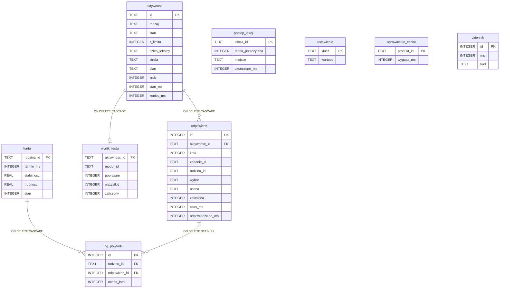

# Dane: model, migracje, kopie, eksport (rola 05 E2, 2026-11-04)
Decyzje: ADR 0002 (SQLite w `Documents/SQLite`), 0003 (port z kolejką, UPSERT, runner `user_version`, dziennik `DELETE`), 0004 (`postep.db` od zera), 0005 (treść osobno, baza na język), 0006 (pamięć uprawnień), 0007 (limit), 0008 (eksport JSON), 0010 (maszyny stanów). Schemat: [`schemat.sql`](schemat.sql) (migracja v1) + [`schemat-v2.sql`](schemat-v2.sql) (migracja v2: `wariant_historia`, D-532). Dowód: [`eksperymenty/e2-schemat.mjs`](eksperymenty/e2-schemat.mjs), wynik [`e2-schemat.wynik.txt`](eksperymenty/e2-schemat.wynik.txt).

## Dowód uruchomienia
Komenda (z katalogu `docs/architektura/eksperymenty`): `node --no-warnings e2-schemat.mjs ../schemat.sql <katalog-tymczasowy>` → **43 wyniki zgodne, kod wyjścia 0** (SQLite 3.53.4, Node 22.23.4, 2026-11-04). Obejmuje:
- schemat przez runner migracji: `user_version` = 1, `PRAGMA integrity_check` = `ok`, `PRAGMA foreign_key_check` pusty, `journal_mode` = `delete`, drugie uruchomienie bez zmian;
- stany domeny = listy w CHECK (`aktywnosc.rodzaj`, `aktywnosc.stan`, `odpowiedz.ocena`);
- 7 przypadków odrzucenia przez CHECK i klucze obce;
- UPSERT odpowiedzi kroku (ten sam `id`, jeden wiersz) i karty (logi zostają); kontrola wzoru: `INSERT OR REPLACE` na karcie kasuje logi;
- kaskady aktywność → odpowiedzi i wynik testu, karta → log; usunięcie odpowiedzi → `log_powtorki.odpowiedz_id` = NULL;
- dane w skali 3 lat (34 005 odpowiedzi i logów, 2 267 aktywności, 530 kart): 6 zapytań głównych ekranów korzysta z indeksu (`SEARCH … USING INDEX`), plik 6,23 MB;
- eksport → import na czystej bazie: 0 różnic w 7 tabelach; odrzucenie pliku z nowszej wersji, obcego i uciętego oraz awaria w środku importu — dane bez zmian;
- „Usuń postęp”: tabele postępu puste, dzisiejsze zużycie limitu i pamięć uprawnień zostają.

Poprawki testu przed ostatnim przebiegiem (nazwane): 7b — oczekiwana liczba znaczników dnia liczona przed usunięciem zamiast stałej 1 (dane 3-letnie zawierały 3 aktywności z tego dnia; zachowanie było poprawne).

## Model (ERD)

Identyfikatory treści (`zadanie_id`, `rodzina_id`, `lekcja_id`, `modul_id`, scenariusz w `plan`) wskazują bazę treści (inny plik, ADR 0005) bez klucza obcego; brak w treści → wiersz zostaje, ekran go pomija (BR-DANE-004).

## Przepływ → tabele (każda tabela wynika z przepływu kontraktu)
| Przepływ / funkcja | Zapis | Tabela |
|---|---|---|
| PR-01 ocena poziomu (F-01) | przebieg i odpowiedzi; punkt startu | `aktywnosc` (`ocena_poziomu`, `z_limitu`=0), `odpowiedz`; `ustawienie.punkt_startu` |
| PR-02 lekcja i test (F-03, F-04) | miejsce w lekcji, ukończenie; ćwiczenia lekcji; podejście do testu | `postep_lekcji`; `aktywnosc` (`lekcja`, `test_modulu`), `odpowiedz`, `wynik_testu` |
| PR-03 sesja (F-07, F-05, F-08, F-09) | sesja w toku i odpowiedzi; zużycie limitu | `aktywnosc` (`sesja`, `z_limitu`=1 bez Pro), `odpowiedz` |
| PR-04 powtórki (F-10) | karty FSRS i log | `karta`, `log_powtorki`, `aktywnosc` (`powtorki`) |
| PR-05 scenariusz (F-12) | decyzje i podsumowanie | `aktywnosc` (`scenariusz`), `odpowiedz` (krok = decyzja) |
| PR-06 zakup (F-13) | ostatni udany odczyt uprawnień | `uprawnienie_cache` |
| F-18 limit | starty aktywności dnia | `aktywnosc` (`z_limitu`, `dzien_lokalny`, `strefa`) |
| F-11, F-16, F-17, F-14 | przypomnienie, język, czas ostatniej prośby o ocenę (L7-13a), data ostatniego eksportu | `ustawienie` (klucze: `przypomnienie`, `jezyk`, `opinie`, `ostatni_eksport`) |
| polityka błędów (ADR 0009) | dziennik lokalny | `dziennik` |

## Polityka migracji
- Wersja w `PRAGMA user_version`; migracje to lista `{ wersja, sql, przebudowa }` w jednym module pakietu danych (moduły: [`moduly.md`](moduly.md)); runner jak w `e1-sqlite.mjs` / `e2-schemat.mjs`, uruchamiany po `PRAGMA foreign_keys = ON` i przed pierwszym zapisem.
- Dodanie kolumny, tabeli, indeksu: zwykła migracja w transakcji. Każda inna zmiana tabeli: 12 kroków (sqlite.org/lang_altertable.html §8), `foreign_keys=OFF` przed `BEGIN`, `foreign_key_check` przed `COMMIT` (E4a–E4e).
- Przed migracją z przebudową: kopia `VACUUM INTO` do `Documents/SQLite/postep-przed-v<N>.db`; usunięcie po udanym starcie.
- Wydanej migracji się nie zmienia. Do pierwszego wydania sztafety v1 można poprawiać (brak baz u użytkowników, D-124); od pierwszego wydania: wzorzec `bazy/v1.db` z danymi brzegowymi i test migracji na kopii każdej wydanej wersji (rola 07).
- Baza nowsza niż aplikacja (np. kopia iCloud z nowszej wersji na starszej aplikacji): runner zgłasza błąd, dane bez zmian (E4f); ekran stanu projektuje rola 04 („zaktualizuj aplikację”).

## Polityka kopii i przeniesienia
- Kopia systemowa iCloud obejmuje `Documents/SQLite/postep.db` (tryb `DELETE`: plik spójny po `COMMIT`). Treść (`tresc-*.db`) jest odtwarzalna z paczki; wyłączenie jej z kopii (`isExcludedFromBackup`) to brzegowa optymalizacja ok. 1 MB `[DO USTALENIA]` (rola 08: czy expo-file-system 58 ustawia ten atrybut).
- Kopia działającej bazy (przed importem, przed migracją z przebudową): `VACUUM INTO ?` przez port (stały SQL z parametrem ścieżki) albo `backupDatabaseAsync`; nigdy kopia pliku.

## Format eksportu (wersja 1)
```json
{ "format": "szkola-pokera-postep", "wersja_formatu": 1, "utworzono": "2026-11-04T12:00:00.000Z", "aplikacja": "1.0.0",
  "dane": { "ustawienie": [], "postep_lekcji": [], "aktywnosc": [], "odpowiedz": [], "wynik_testu": [], "karta": [], "log_powtorki": [] } }
```
- Od migracji v2 (D-532) plik ma ósmą tabelę `wariant_historia` (historia odcisków wariantów scenariuszy, okno 20 na szablon i poziom); `wersja_formatu` zostaje 1. Plik sprzed v2 bez tej tabeli się importuje: brak = pusta historia (tylko ta tabela jest opcjonalna, pozostałe 7 wymagane; `packages/domena/src/eksport.ts`). Import zastępuje historię, „Usuń postęp” ją czyści.
- Wiersze jak w tabelach (nazwy kolumn = klucze). Poza plikiem: `uprawnienie_cache` (przywraca sklep), `dziennik`.
- Import: walidacja całości przed dotknięciem bazy (obcy `format`, zła struktura, ucięty plik → `bledny_plik`; `wersja_formatu` wyższa → `nowsza_wersja`); potwierdzenie przy istniejącym postępie; kopia `VACUUM INTO`; jedna transakcja: usunięcie (dzieci przed rodzicami), wstawienie, `foreign_key_check`; błąd → `ROLLBACK`. Dzisiejsze aktywności z limitu, których nie ma w pliku, zostają (ADR 0007).
- Starsza `wersja_formatu` przechodzi przez czystą funkcję migracji formatu przed walidacją.
- Pomiar (nie budżet): plik eksportu w skali 3 lat Pro = **12,15 MB** (szacunek E0 „ok. 5 MB” był za niski: JSON powtarza nazwy kolumn w każdym wierszu). Wpływ: brzegowy (arkusz udostępniania przyjmuje taki plik, import w jednej transakcji przeszedł w teście). Zmniejszenie (tablice wartości zamiast obiektów albo kompresja) tylko nowym `wersja_formatu`, jeśli pomiar na iPhonie pokaże problem (E3).

## „Usuń postęp” (BR-DANE-003)
W jednej transakcji: odpowiedzi dzisiejszych aktywności z limitu usunięte, te aktywności zostają jako puste znaczniki (`porzucona`, `plan` = `{}`), pozostałe aktywności, karty, log, postęp lekcji, ustawienia i dziennik usunięte; `uprawnienie_cache` zostaje. Potem usunięcie starych plików `user.db*` (ADR 0004). Ustawienia urządzenia (np. zgoda na powiadomienia) zostają w systemie; zaplanowane przypomnienie jest anulowane, bo `ustawienie.przypomnienie` znika (ADR 0012) — tekst potwierdzenia mówi to wprost (rola 04).

## Ścieżki utraty danych
| Ścieżka | Zabezpieczenie | Test |
|---|---|---|
| Aktualizacja ze zmianą schematu | runner 12 kroków, `foreign_keys=OFF` przed `BEGIN`, `foreign_key_check`, kopia `VACUUM INTO` przed przebudową | test migracji na kopii każdej wydanej wersji: liczności, `integrity_check`, `foreign_key_check`, drugie uruchomienie (E4a–E4c) |
| Migracja z danymi łamiącymi nowe CHECK | cała migracja w transakcji | E4e: wycofanie, wersja i dane bez zmian |
| Baza nowsza niż aplikacja | odmowa migracji | E4f |
| Zapis spoza transakcji wpada do cudzej transakcji i ginie przy `ROLLBACK` | jedna kolejka zapisów w porcie | E1a/E1b; test adaptera expo-sqlite na urządzeniu (rola 07) |
| `INSERT OR REPLACE` kasuje dzieci kaskadą | UPSERT; zakaz w kontroli statycznej | E2a/E2b, 4b/4c |
| Klucze obce wyłączone na połączeniu (kaskady nie działają, sieroty) | `PRAGMA foreign_keys = ON` przy otwarciu, poza transakcją; zakaz `withExclusiveTransactionAsync` | E1c/E1d, E3b/E3c; kontrola `PRAGMA foreign_keys` w transakcji = 1 |
| Przerwanie w środku sesji (zabicie procesu) | stan i odpowiedź w jednej transakcji przed pokazaniem następnego kroku; UPSERT kroku | 4a; test przerwania z ADR 0010 |
| Zawieszenie aplikacji z blokadą pliku (`0xdead10cc`) | krótkie transakcje, nic nie czeka w transakcji (sieć, sklep, dialog); długie operacje pod `beginBackgroundTask` z wycofaniem przy wygaśnięciu (ADR 0013, odczyt Apple 2026-11-04) | `e3-blokady-czasy.mjs` (2a–2f); K-10; scenariusz U-2 na urządzeniu |
| Błąd zapisu, pełny dysk | komunikat, stan bez zmian, dane w formularzu (polityka błędów) | test wstrzykniętego błędu portu (rola 07) |
| Import złego pliku | walidacja przed zmianą bazy | 6d–6f |
| Awaria w środku importu | jedna transakcja + kopia przed importem | 6g |
| Import nadpisuje istniejący postęp | potwierdzenie (BR-DANE-002) | test interfejsu (rola 07) |
| Kopia przy WAL bez pliku `-wal` | tryb `DELETE`; kopie przez `VACUUM INTO` | E5a/E5b, 1d |
| Nowy telefon bez eksportu | kopia iCloud (baza w dokumentach) | krok właściciela T-06 (przywrócenie z kopii jako wariant) |
| Podmiana treści usuwa zadanie z powtórek | identyfikatory bez kluczy obcych, pomijanie brakujących | test BR-DANE-004 (ADR 0005) |
| Stare bazy z buildów 1005–1008 | nietknięte (`postep.db` pod nową nazwą) | test sum SHA-256 (ADR 0004) |
| Usunięcie postępu bez intencji | potwierdzenie; transakcja | 7a–7e; test rezygnacji (rola 07) |
| Zwrot / ponowna instalacja kasuje dostęp | dostęp ze sklepu, pamięć tylko podręczna | 9 wektorów logiki dostępu (ADR 0006) |
